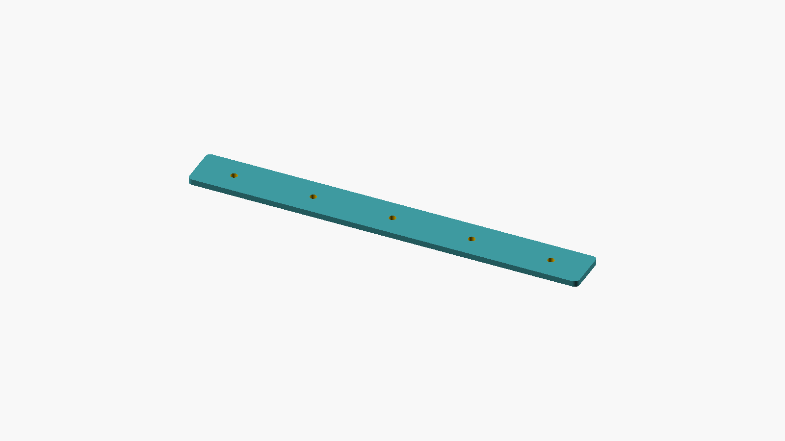

# Sewlore Parametric Button-Centre Rail

One self-contained OpenSCAD script creates a flat rail with equally spaced centre-marking holes. Choose either **Spacing** mode to enter the adjacent centre gap, or **Length** mode to fit a set number of centres between the first and last edge margins. Left and right margins can differ. The purpose is to plan and transfer button **centre** positions; the holes do not represent button diameter or buttonhole length.

## Defaults and calculation

The included default STL is **160 × 18 × 2.4 mm**, with **5** holes of **2.8 mm** nominal diameter, **15 mm** left/right edge-to-centre margins and **32.5 mm** adjacent centre spacing. Centre X positions are **15, 47.5, 80, 112.5 and 145 mm**. All holes sit at Y = 9 mm. The underside is flat at Z = 0.

- Spacing mode: `length = left_margin + (count - 1) * spacing + right_margin`.
- Length mode: `spacing = (length - left_margin - right_margin) / (count - 1)`.
- Centre `i` is at `left_margin + i * spacing`, for `i = 0 ... count - 1`.

## Customize

Open `sewlore-parametric-button-centre-rail.scad` in OpenSCAD and use the Customizer panel. On a compatible parametric model service, upload this single `.scad` file; it has no imports, fonts or libraries. MakerWorld upload and server compatibility have not yet been verified.

| Parameter | Supported setting | Meaning |
|---|---:|---|
| `layout_mode` | Spacing / Length | Which measurement drives the layout |
| `button_count` | 2–20, integer | Number of marker holes |
| `centre_spacing` | 5–80 mm | Used in Spacing mode |
| `rail_length` | 40–250 mm | Used in Length mode |
| `left_margin`, `right_margin` | 4–40 mm each | Outer edge to first/last hole centre |
| `guide_diameter` | 0.8–6 mm | Nominal marker aperture |
| `rail_width` | 10–30 mm | Overall width |
| `rail_thickness` | 1.2–5 mm | Overall thickness |
| `corner_radius` | 0–5 mm | Outer corner rounding; zero gives square corners |

Not all slider combinations are valid. The script rejects a resulting length outside 40–250 mm, a resulting spacing outside 5–80 mm, holes with less than 1.5 mm of digital material between/around them, and end holes too close to a rounded corner. Corner radius must also be less than half the rail width. Invalid settings show an explanatory assertion rather than a misleading clamped shape. Change the dimensions and render again. The 1.5 mm threshold is a geometric rule, **not** a strength recommendation.

Use **Render (F6)** before STL export. Keep exported coordinates in millimetres and verify the dimensions in your slicer. Changing the script does not change the included default STL; generate a new export for every customized set.

Example Length-mode variant: 200 mm length, 6 centres, 12/18 mm margins produces 34 mm centre spacing at X = 12, 46, 80, 114, 148, 182 mm. The supplied `preview-length-mode.png` is a native render of this variant, not the default STL.

## Use and limits

This is an **unprinted digital CAD prototype**. No physical printing, marker-fit, material-strength, dimensional-tolerance or sewing tests have been performed. Printer bed fit is not guaranteed by the allowed length range. Before use, check the physical dimensions and finish, select a marker that fits the actual aperture, and try marking on scrap fabric. Do not use the rail as a cutting guide. It has no cutting blade and does not calculate finished buttonhole size.

To transfer a planned set of centres, align the long side with a separately established button line, position the first centre at its required location, hold the rail still and mark through the apertures. Check the resulting centre distances with a separate ruler. Choose the first/last garment positions from the actual sewing pattern.

For measurement definitions and recording context, see the [Sewlore fabric measurement methods guide](https://sewlore.com/pages/fabric-measurement-methods-guide).

## Digital verification and license

Native **OpenSCAD 2021.01** CGAL exports were independently inspected with **trimesh 5.1.1**. Eight valid default/boundary/variant combinations produced one connected, watertight, consistently wound solid with the expected dimensions, hole topology and near-analytic volume. Seventeen invalid combinations were rejected with assertions and did not produce STL files. See `digital-qa-summary.json` for the exact cases and scope.

The three PNGs are unmodified native OpenSCAD render exports. They show geometry, not physical specimens. No telemetry, automatic network requests, tracking parameters, mandatory hyperlink or watermark is embedded in the CAD or STL.

MIT license. Copyright (c) 2026 Sewlore. Original AI-assisted source. See `LICENSE` and `NOTICE`.
